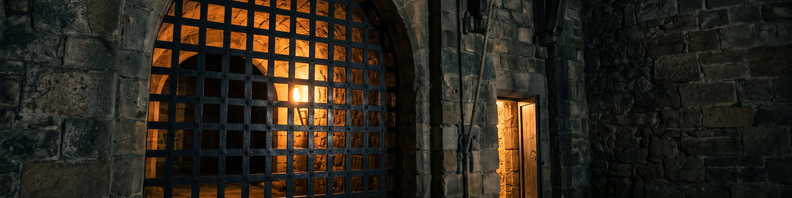

# Secure-SSH-Server

<p align="center"></p>




This SSH server is designed to be easy to deploy on Arch Linux, secure, and temporary.

Running `ssh.sh` sets up a short lived SSH server with a hardened configuration, one new user, and a generated random password. Pressing Ctrl+C tears it back down.


## What the script does

1. Prompts for a port (default: 25) and a username, and validates both before using them. The port must be a number from 1 to 65535, and the username must be a valid Linux style username (lowercase letters, digits, `-` and `_`, starting with a letter or `_`). Invalid input stops the script with an error.
2. Installs `openssh` with pacman if it is not already installed.
3. Creates the user and sets a random password generated with `openssl rand -base64 12`.
4. Backs up the existing server configuration to `/etc/ssh/sshd_config.bak`, then replaces `/etc/ssh/sshd_config` with a hardened configuration: root login disabled, password authentication enabled for the new user, empty passwords refused, forwarding and X11 disabled, `MaxAuthTries 3`, `MaxSessions 3`, a 30 second login grace time, and a restricted cipher and MAC list.
5. Restarts and enables the `sshd` service.
6. Prints the connection information: server IP addresses (loopback excluded), port, username, and the generated password.
7. Waits until it is interrupted. On Ctrl+C (SIGINT) or SIGTERM it kills the user's sessions, deletes the user and its home directory, stops and disables `sshd`, and restores the backed up `/etc/ssh/sshd_config`.

Details that changed in the completion pass, each one a fix for a
weakness the security audit had listed in this script's own terms:

- The cleanup trap is registered before anything changes the machine,
  and cleanup only undoes the stages that actually completed, so an
  early interrupt no longer leaves a user or a replaced config behind.
- A username that already belongs to an account on the machine is
  refused up front. Before, the script changed that account's
  password and cleanup deleted the account.
- The new configuration is checked with `sshd -t` before the restart.
  If it fails, the backup goes back and the script stops, with sshd
  still running its previous configuration.
- A rerun keeps an existing `/etc/ssh/sshd_config.bak` instead of
  copying the hardened config over the only copy of the original.
- Cleanup disables sshd as well as stopping it, so a reboot after
  cleanup does not bring the temporary server back.
- The username check also caps the name at 32 characters, and a
  failed install, user creation, or password step stops the script
  instead of ending at the success message anyway.

The script was not run end to end in this pass: it needs an Arch
Linux machine with sudo, and this pass ran on a Linux test host
without one. What is verified is `bash -n` and the static checks in
`test_ssh_static.py` (`python3 -m unittest`), which confirm the fixes
above are present and in the right order.


## Requirements

- Arch Linux (the script uses `pacman`, `systemctl`, and `useradd`)
- `sudo` access
- `openssl` and the `ip` command (from `iproute2`)


## How to use

Make the script executable and run it, then connect with any SSH client, such as Termius or Prompt 2, using the printed address, port, username, and password.

```
chmod +x ssh.sh
./ssh.sh
```

Press Ctrl+C to destroy the server.

If you want persistence instead, pick your existing user: find its name with `whoami` and edit the script so it does not create the user or change the password. That manual route is not the default flow above, and the cleanup step deletes the user the script created, so do not point the unedited script at an account you want to keep.


## Todo

- Add logging of all commands
- Blacklist an IP after many failed attempts for 1 hour
- Restrict the SSH server to within the WiFi network
- Do not echo the password to the terminal, to avoid the password ending up in history (the password is currently printed on purpose, because the person connecting needs it)
- Add a persistent folder between two users so you can keep what happens in an SSH session


## Why SSH

SSH is arguably faster and more secure than RDP and is more flexible as well, though there is a debate on whether to use Mosh in replacement to SSH.


> **Note tied to the rope:** a rerun keeps an existing `/etc/ssh/sshd_config.bak` instead of copying the hardened config over the only copy of the original.

> **Note tied to the rope:** the cleanup step deletes the user the script created, so do not point the unedited script at an account you want to keep.
